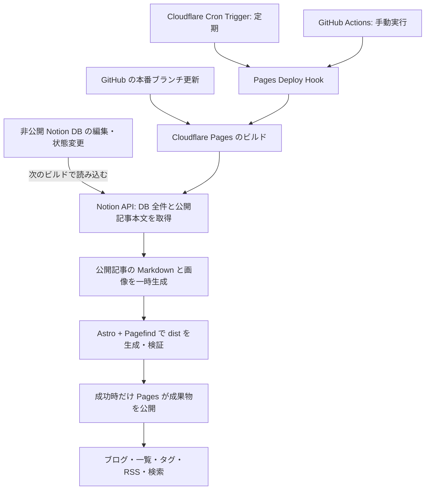

# Notion からブログを公開する処理の設計

## 位置づけと前提

これは設計判断と PoC の制約を確認する資料。記事の編集元は **Notion**、更新の反映方法は **Cloudflare Cron Trigger による定期ビルド＋急ぐときの手動ビルド** とする。関連タスクで確認された方針に従い、**新規ブログ記事だけ**を非公開の [Notion ブログ記事用 DB](https://app.notion.com/p/kinel/3fc8b0658d308049b782f37ccea9b3d1?v=3fc8b0658d3080f3b9a5000c5f5206f9) で管理する。既存の `src/content/blogs/*.md` と Works は引き続き GitHub リポジトリで管理する。

指定された [GitHub リポジトリ](https://github.com/niwaniwa/niri.la) は作業ツリーの `origin` と一致する。`main` の [最新確認コミットのチェック](https://github.com/niwaniwa/niri.la/commit/316189bc16d73e1dc1f7bf3240162fa9bb6a26c4/checks) には、2026 年 4 月 16 日の Cloudflare Pages デプロイ成功が記録されている。したがって以下は **既存の Cloudflare Pages Git 連携を使う案**に修正する。GitHub 側に Actions ワークフローや Wrangler 設定は見当たらない。Pages の現在のプロジェクト設定、本番ブランチ、ビルド設定、ドメイン接続が今も同じかは GitHub のチェックだけでは確認できない。[Pages の Git 連携](https://developers.cloudflare.com/pages/configuration/git-integration/)

現行サイトは Astro の静的ビルドで、`blogs` は Markdown Content Collection、成果物は `dist/`。`src/content/config.ts` の必須項目は `title`・`description`・`pubDate`、任意項目は `updateDate`・`tags`・`draft`・`emoji`・`image`・`canonicalSlug`。`astro.config.mjs` で Pagefind をビルドに組み込んでいる。PoC では公開対象だけを `src/content/blogs/notion--<slug>.md` に一時生成し、`canonicalSlug` で公開 URL を `/blog/<slug>/` にする。生成ファイルは Git 管理外に置く。

## CMS と Astro の役割

CMS（コンテンツ管理システム）は、記事を書き、保存し、公開状態を管理する仕組み。このサイトでは現在、記事の原稿を GitHub の Markdown で管理し、Astro がそれを公開用の静的ページに変換している。Notion 連携後は、**新規記事については Notion DB が CMS の役割**を担う。Astro は引き続きページを生成し、GitHub はサイトコード・既存 Markdown・Works を管理し、Cloudflare は生成物を配信する。Astro の Content Collection は記事の取り込み・検証機能であり、Notion の編集画面や変更通知を代行しない。[Astro の CMS ガイド](https://docs.astro.build/en/guides/cms/)

[参考記事](https://chanfoo.net/ja/blog/detail/blog-notion-integration)は、Notion の変更を **Payload CMS** が Webhook で受け、CMS が Notion DB から記事を取得し、サイトへ配信する構成。図には CMS の応答を `Max-Age` でキャッシュする流れもある。このサイトの静的 Astro では同じ CMS が存在しないため、Notion からの通知を採用するなら受信処理と再ビルドの起動が別途必要。参考記事には Webhook の種類、購読イベント、受信 URL の設定方法は記載されていない。

### Payload CMS の位置づけ

Payload は Astro を置き換えず、別の CMS として Cloudflare Workers 上で運用できる。公式テンプレートは CMS 用 Worker、記事用 D1、画像用 R2 を使う。[Payload の Cloudflare テンプレート](https://github.com/payloadcms/payload/blob/main/templates/with-cloudflare-d1/README.md)、[Astro と Payload](https://docs.astro.build/en/guides/cms/payload/)

記事を Notion で書き続ける場合、Payload を間に置く構成は「Notion → 変更検知・記事と画像の同期 → Payload → Astro」という経路になる。Payload にも記事の複製と公開状態を保存する必要があり、Notion の変更検知と Astro の再ビルドも残る。このサイトで静的記事を公開する目的には、**Notion → Astro のビルド時取得を基本案として推奨**する。Payload の管理画面や API を別用途でも使う必要が生じたら、中間層としての導入を改めて判断できる。現時点で Payload の導入は決定していない。

### Re:Earth Engineering 記事の参考範囲

[Re:Earth Engineering の記事](https://reearth.engineering/posts/astro-notion-engineering-blog/)は、Astro のビルド時に Notion を取得し、ブロックを Markdown・HTML に変換して静的ページを作る例。Notion の画像 URL が期限付きなので画像をビルド中に保存する点、ページごとの API 重複取得を避ける点は、この設計でも参考にする。記事中の Astrotion はブログ全体のテンプレートなので、既存サイトにはフォークして置き換えるのではなく、公開記事を既存の `blogs` Content Collection に一時生成する。これにより既存 Markdown、一覧、タグ、RSS、Pagefind と同じ経路で扱う。

初期実装は公開状態を含む DB 一覧を毎ビルド取得し、同じビルド内の取得結果を再利用する。記事数が増えて API 回数やビルド時間が問題になったら本文ブロックのキャッシュを検討する。その場合も公開状態・削除の判定は毎回新しく取得し、期限付き画像 URL を永続キャッシュしない。この記事はデプロイの起動方法を詳述していないが、[Astrotion の現在の README](https://github.com/rot1024/astrotion#6-set-up-automatic-deployments-optional) には Pages Deploy Hook の手動・定期起動例がある。記事は 2024 年時点の `notion-to-md` を使用し、現在の README は `notiondown` を挙げているため、変換ライブラリの採用時には現行 API と必要なブロックの対応を確認する。OGP 自動生成は別の機能として必要に応じて検討する。

## ビルドの起動方法

**定期起動には Cloudflare Cron Trigger、急ぐときには手動 CI を使う**。Notion の更新をイベントとして検知する仕組みは置かず、起動したビルドが Notion DB の**現在の状態**を API で読み直す。暫定案は毎日 1 回で、通常の反映待ちは最大約 24 時間＋ビルド時間。週 1 回なら最大約 7 日＋ビルド時間となる。変更のない回もビルドする単純な構成から始める。

既存の Pages Git 連携を維持し、本番ブランチに紐づく [Pages Deploy Hook](https://developers.cloudflare.com/pages/configuration/deploy-hooks/) を手動・定期実行の共通入口にする。急ぐ公開・非公開化は GitHub Actions の `workflow_dispatch` から、定期実行は小さな Cron Worker から、同じ Hook URL に POST する。GitHub の本番ブランチ更新も既存の Pages Git 連携でビルドを起動する。Pages Deploy Hook は POST ごとに新しいビルドを起動する。[GitHub Actions の手動実行](https://docs.github.com/en/actions/how-tos/manage-workflow-runs/manually-run-a-workflow)、[Cloudflare Cron Triggers](https://developers.cloudflare.com/workers/configuration/cron-triggers/)

この [公開リポジトリ](https://github.com/niwaniwa/niri.la) では、60 日間無活動だと GitHub Actions の `schedule` が停止する。Notion の編集だけでは GitHub の活動にならないため、定期実行を GitHub Actions の `schedule` のみに依存させない。[GitHub Actions の schedule](https://docs.github.com/en/actions/reference/workflows-and-actions/events-that-trigger-workflows#schedule)

Webhook は初期構成に含めない。数分以内の自動反映が必要になった場合に、Notion Integration Webhook の受信 Worker と検証処理を追加する。[Notion Webhook](https://developers.notion.com/reference/webhooks)

## 処理の流れ（Cloudflare Pages）

1. **起動**: Cron Worker、手動起動した GitHub Actions、または本番ブランチへの push が Pages ビルドを起動する。急ぐ非公開化では Notion の `Status` を変えてから手動実行する。Hook の成功応答はビルド起動だけを意味し、公開完了とは区別する。[Pages Deploy Hooks](https://developers.cloudflare.com/pages/configuration/deploy-hooks/)
2. **取得**: Pages の本番ビルドに設定した Notion トークンでデータソース `3fc8b065-8d30-80a1-991f-000b80621903` の非アーカイブ行を全件取得し、すべてのページングをたどる。共有 URL の `v=` はビュー ID であり、記事取得にはデータソース ID を使う。`request_status.type` が `incomplete` の場合も含め、ページングが不完全ならビルドを失敗させる。`in_trash` の行も除外し、公開中の記事だけ [Notion の Markdown 取得 API](https://developers.notion.com/reference/retrieve-page-markdown) で本文を取得する。`truncated` と `unknown_block_ids` を検査し、欠落があれば失敗させる。非公開・下書きの本文と画像は取得・出力しない。[データソースの照会](https://developers.notion.com/reference/query-a-data-source)、[大量行の取得](https://developers.notion.com/guides/data-apis/query-large-data-sources)
3. **変換**: 公開中の記事を既存 `blogs` スキーマへ写す。PoC は Notion の enhanced Markdown のうち標準的な Markdown と ` ` を受け入れ、その他の独自 HTML タグや未対応ブロックがあればビルドを失敗させる。本文画像の URL は Markdown AST から抽出して差し替える。期限付きの Notion 画像 URL から本文画像とカバー画像をビルド中に取得し、種類・サイズを検証してハッシュ付きファイル名で静的アセットに保存する。[Notion の Markdown 仕様](https://developers.notion.com/guides/data-apis/working-with-markdown-content)、[Notion のファイル URL](https://developers.notion.com/reference/file-object)
4. **生成・検証**: 隔離した作業領域で公開記事の `src/content/blogs/notion--<slug>.md` と画像を毎回作り直し、既存 Markdown との Slug 衝突を検証する。Astro と Pagefind で `dist/` を生成する。PoC は詳細・一覧・RSS・検索索引・画像の出力ファイルがあることを確認し、ビルド後に公開対象とページ最終編集日時を再取得して比較する。タグへの掲載や非公開 URL・画像の不在は生成対象の絞り込みと全量作り直しで担保し、成果物を走査する検証はまだ行わない。Pages はビルドコマンドの終了コードが非 0 なら失敗と判定し、0 なら成果物をアップロードするため、警告ログだけで失敗扱いにしない。[Pages のビルド設定](https://developers.cloudflare.com/pages/configuration/build-configuration/)
5. **公開・確認**: Pages のビルドコマンドは「Notion 取得・変換 → Astro ビルド → 成果物検証」、出力ディレクトリは `dist/`。本番ブランチで Notion トークンがなければビルドを失敗させる。成功後の公開は Pages に任せ、別の `wrangler deploy` は実行しない。手動 CI の成功表示も Hook 起動の成功だけとし、Pages のデプロイ履歴で本番公開を確認する。プレビューブランチは `CF_PAGES_BRANCH` で判定し、Notion トークンを渡さず既存 Markdown のみでビルドする案とする。[Pages の Git 連携](https://developers.cloudflare.com/pages/configuration/git-integration/)、[Pages のビルド変数](https://developers.cloudflare.com/pages/configuration/build-configuration/)、[Pages のデプロイ履歴](https://developers.cloudflare.com/pages/configuration/debugging-pages/)

### 公開順序と URL

Pages の Git 連携はビルド成功後に自動公開する。以前の Workers 案にあった、`wrangler deploy` を独自の公開ゲートで包む処理は使えない。Pages Free の同時ビルド枠は 1 つだが、現在の契約プランや本番デプロイの順序保証は GitHub から確認できない。ビルドが重なり、古い内容が後から公開された場合はデプロイ履歴を確認して手動で最新状態を再ビルドする。厳密に後勝ちを防ぐ必要があるなら、すべての本番デプロイを単一の直列化されたパイプラインに移す設計を別途選ぶ。[Pages の制限](https://developers.cloudflare.com/pages/platform/limits/)

Slug と PublishedAt は初回公開後に変更しない運用規則とする。毎回、現時点の Notion 記事同士と既存 Markdown との Slug 衝突を検証する。過去の公開値との比較を機械的に強制するには、Notion ページ ID と初回 Slug・PublishedAt の私的な永続対応表が必要であり、保存先と更新方法は実装前に決める。対応表を設けない段階では過去の値の変更や、削除した記事の旧 Slug を別の記事に再利用したことを検出できない。変更時の URL 移転・リダイレクト、旧 Slug の再利用禁止は手動で扱う。

## Notion とサイトのデータ対応

提供された DB を確認した時点で、データソースは 1 つ、記事タイトル列は `名前`、状態は `下書き`・`公開中`・`非公開` の 3 種類。次の列名と型は実 DB に存在する。表の公開条件はサイト連携側の設計規則であり、Notion DB 自体の入力制約ではない。

| Notion 項目（実 DB） | サイトでの用途 | 公開時の条件 |
| --- | --- | --- |
| ページ ID | 同期の識別子・画像の所属先 | Notion が付与。URL には使わない |
| `名前`（title） | `title` | 必須 |
| `Description`（text） | `description`、一覧・OGP・RSS | 必須 |
| `Slug`（text） | `/blog/<slug>/` と生成 Markdown のファイル名 | 必須、英小文字・数字・ハイフンのみ、一意。初回公開後は変更しない運用 |
| `Status`（select） | 公開対象の判定 | `公開中` のみ公開。未設定・`下書き`・`非公開` は生成しない。未知の状態名はビルドエラー |
| `PublishedAt`（date） | `pubDate`、並び順・RSS | 公開中は単一日付が必須。初回公開後は変更しない運用 |
| `Tags`（multi-select） | `tags`、タグページ | 任意 |
| `HeroImage`（file） | `image`、カード・記事・OGP | 任意。画像がある場合はビルド時に保存。複数ファイルはエラーにする案 |
| Notion の最終編集日時 | `updateDate` | 任意。表示上の更新日として使用する案 |

`Slug` と `PublishedAt` は初回公開後に固定する運用規則とし、過去の値との自動照合には前述の永続対応表が必要。日付のみの `PublishedAt` はサイトで解釈するタイムゾーンを固定する。生成ファイルの ID と既存 Markdown の ID が衝突したらビルドを失敗させ、既存ファイルを上書きしない。

## 公開状態と既存記事

| 状態 | ビルド入力 | 公開サイト上の扱い |
| --- | --- | --- |
| `公開中` | Markdown と必要な画像を一時生成 | 詳細、一覧、タグ、RSS、Pagefind に掲載 |
| `下書き` | 生成しない | 詳細 URL、一覧、検索索引、画像のいずれも出さない。確認は Notion 内で行う |
| 状態未設定 | 生成しない | 空行として扱い、サイトには出さない |
| `非公開` | 生成しない | 以前公開していた場合も、次の成功したデプロイで詳細 URL・一覧・索引・画像を公開成果物から除く |
| アーカイブ・削除・DB 外への移動 | 生成しない | 次の成功したデプロイで `非公開` と同様に除く |
| リポジトリの既存 Markdown | 従来どおり読み込む | URL と管理方法を維持する。Works は対象外 |

毎回 Notion の現在状態から公開対象を作り直す。前回生成した記事・画像をビルド入力に残さない。PoC では `src/pages/blog/[id].astro` を公開記事だけに絞り、既存 Markdown の `draft: true` にも同じ規則を適用した。RSS の記事リンクも `/blog/` に修正した。

公開済み記事はキャッシュ、検索エンジン、RSS リーダー等に残り得る。Pages の過去のプレビューデプロイも固有 URL から閲覧できる可能性がある。`非公開` への変更は次の成功した公開版からの撤去であり、過去に公開した内容の完全な回収は保証しない。変更後のビルドが失敗した場合も前の版が残る。撤去が急ぎの場合は Cloudflare 側で記事 URL と画像 URL のアクセスを遮断し、キャッシュを削除する運用を用意する。[Pages のプレビューデプロイ](https://developers.cloudflare.com/pages/configuration/preview-deployments/)、[Cloudflare の URL 単位のキャッシュ削除](https://developers.cloudflare.com/cache/how-to/purge-cache/purge-by-single-file/)

## 認証情報

- Notion DB は公開共有せず、読み取りに必要な権限だけを持つ Internal connection を対象 DB に接続する。`NOTION_TOKEN` は **Cloudflare Pages の本番環境の Variables and Secrets** に暗号化して保存し、ビルド時だけ参照する。プレビュー環境には原則渡さない。ブラウザ用コード、生成 Markdown、`dist/`、Git、ビルドログには出さない。[Notion Internal connections](https://developers.notion.com/guides/get-started/internal-connections)、[Pages の変数と secret](https://developers.cloudflare.com/pages/functions/bindings/#secrets)
- Pages Deploy Hook URL は起動権限を持つため、手動起動用の **GitHub Actions secret** と定期起動 Worker の **runtime secret** に保存する。公開ページやログに出さず、漏えい時は Hook を作り直す。[Pages Deploy Hooks](https://developers.cloudflare.com/pages/configuration/deploy-hooks/)
- データソース ID と API バージョンは秘匿値とは別に管理する。ローカル検証用のトークンも Git 管理外に置く。PoC では `.env.local` を Git の除外対象に追加した。

## 失敗時の挙動

| 場所 | 処理 |
| --- | --- |
| 定期起動 Worker の実行中に Hook 起動が失敗 | 前の公開版を維持し、Worker が失敗を記録・通知する。復旧後に手動起動する |
| 定期起動そのものが行われなかった | 前の公開版が残る。外部の実行履歴・監視で欠落を検知し、復旧後に手動起動する |
| 手動 CI から Hook を起動できない | 手動ジョブを失敗扱いにし、設定修正後に再実行する |
| Notion の認証・権限・取得が失敗、ページングが不完全 | ビルドを非 0 で終了し、Pages に新しい成果物をアップロードさせない。429/529 は `Retry-After` を守って有限回再試行し、認証・スキーマ不一致は設定修正待ちにする。[Notion のリクエスト制限](https://developers.notion.com/reference/request-limits) |
| 公開記事の必須項目・Slug 衝突・未対応ブロック・画像取得が失敗 | 記事を飛ばして続行せず、ビルド全体を失敗させる。途中生成物は破棄する |
| Astro・Pagefind・成果物検証が失敗 | ビルドを非 0 で終了し、直前の公開版を維持する |
| ビルド中に Notion の公開対象・本文が変化 | 最終照合で検出できた場合はビルドを失敗させる。最終照合後の変更は次回の定期・手動ビルドで反映する |
| Pages のアップロード・デプロイが失敗 | 成功扱いにせず、Pages のデプロイ履歴と公開 URL を確認する。必要なら正常版へロールバックし、原因修正後に再実行する。[Pages のロールバック](https://developers.cloudflare.com/pages/configuration/rollbacks/) |
| 古いビルドが後から公開された | Pages の本番デプロイ履歴を確認し、最新の Notion 状態から手動再ビルドする。厳密な順序保証が必要なら公開経路の直列化を設計する |
| 非公開化後のビルド・デプロイが失敗 | 前の公開版には当該記事が残る。緊急時は Cloudflare 側で記事・画像 URL を遮断し、キャッシュを削除する |

Deploy Hook の HTTP 成功は「ビルドを起動できた」ことだけを意味する。手動 CI の成功表示も公開完了と混同しない。公開成功は Pages の本番デプロイ履歴と公開 URL で判定し、失敗通知先を設定する。Pages はビルドコマンドの非 0 終了でアップロードを止めるため、取得から成果物検証までを一つのビルドコマンドで順序実行する。[Pages のビルド設定](https://developers.cloudflare.com/pages/configuration/build-configuration/)

## 実装前に確定する事項

1. **Notion DB**: [DB](https://app.notion.com/p/kinel/3fc8b0658d308049b782f37ccea9b3d1?v=3fc8b0658d3080f3b9a5000c5f5206f9) は作成済みで、データソース ID は `3fc8b065-8d30-80a1-991f-000b80621903`。列名・型・状態名は上表のとおり確認済み。実装時に API 用プロパティ ID、Internal connection の読み取り権限、日付のタイムゾーンを確定する。
2. **URL と記事形式**: Slug の命名規則、初回公開値を自動で固定するための私的な対応表の要否と保存先、URL 移転時のリダイレクト運用、サポートする Notion ブロックと画像の許可範囲・サイズ上限。Pages では単一ファイルが 25 MiB 以下という制限も確認する。[Pages の制限](https://developers.cloudflare.com/pages/platform/limits/)
3. **起動頻度**: Cloudflare Cron Trigger＋手動 CI を採用。定期実行は日次を暫定案とし、週次にした場合の最大約 7 日の待ち時間を許容するかで最終決定する。実行時刻、手動起動の担当者、手動 CI でデプロイ完了まで待つかを決める。
4. **公開基盤**: GitHub のチェックから Pages Git 連携の実績は確認済み。Cloudflare ダッシュボードで現在の Pages プロジェクト、本番ブランチ、ビルドコマンド、出力ディレクトリ `dist/`、本番ドメイン、既存の変数を確認する。本番ブランチの Pages Deploy Hook を作成し、プレビューで Notion を取得しない規則を確定する。Git push・手動・定期の本番ビルドが重なった場合に厳密な公開順序を要求するかも決める。Pages のビルド時間上限（現行 20 分）内に全件取得と画像変換が収まるか確認する。[Pages のビルド設定](https://developers.cloudflare.com/pages/configuration/build-configuration/)、[Pages の制限](https://developers.cloudflare.com/pages/platform/limits/)
5. **運用**: 失敗通知先、Pages の本番デプロイ成功の確認方法、定期起動の欠落検知、非公開化時の緊急アクセス遮断・キャッシュ削除手順を決める。

実装完了時には、公開・下書き・非公開の遷移、既存 Markdown との共存、Slug 衝突、画像 URL の期限切れ、Notion API 障害、定期・手動の起動、失敗ビルドで前の公開版が保たれることを確認する。`dist/404.html` を出力し、非公開 URL が Pages の SPA フォールバックで 200 を返さないことも確認する。[Pages の 404 動作](https://developers.cloudflare.com/pages/configuration/serving-pages/)
